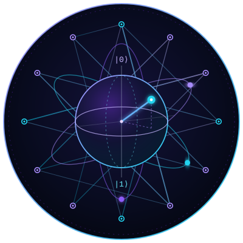

 

**Vishal R.** &nbsp;·&nbsp; B.Tech Electronics & Communication Engineering &nbsp;·&nbsp; VIT Chennai

`Quantum ML` &nbsp; `LLMs` &nbsp; `Multimodal AI` &nbsp; `Computer Vision` &nbsp; `AI for Science` &nbsp; `Edge AI`

## `01` — About

I'm an Electronics and Communication Engineering student at VIT Chennai, interested in what happens where quantum computing meets modern AI. I like building research-oriented systems that can be tested end to end: speech and vision models, sensor-driven data pipelines, and embedded prototypes.

My goal is to understand how these models work and to build practical systems around them, from segmentation networks to wearable hardware.

## `02` — Research & technical interests

<table>
<tr>
<td align="center" valign="top" width="33%">

**Quantum computing**

Quantum algorithms · quantum machine learning · Qiskit

</td>
<td align="center" valign="top" width="33%">

**LLMs & multimodal AI**

Transformers · speech and language · multimodal learning

</td>
<td align="center" valign="top" width="33%">

**Vision, science & edge**

Computer vision · AI for science · embedded and edge AI

</td>
</tr>
</table>

**Currently working on**

- Deep learning for glacial lake segmentation from satellite imagery, as a research intern at the Centre for Cyber Physical Systems (CCPS), VIT Chennai
- Emotion-aware speech recognition research, combining speech recognition with speech emotion recognition
- Building foundations in quantum computing and modern language models

## `03` — Featured projects

<table>
<tr>
<td width="50%" valign="top">

**EmotionFusionNet** 
Emotion-aware speech recognition

Research combining speech recognition with speech emotion recognition. Work in progress; no public repository yet.

`Speech AI` `Deep Learning` `Research`

<!-- When the code is public, link it here: https://github.com/vishtodev/Emotion_Aware_Speech_Recognition (the repository is currently empty) -->

</td>
<td width="50%" valign="top">

**ToLCV Risk Assessment** 
IoT-AI framework for crop-disease risk

Multi-node framework for whitefly propagation forecasting and Tomato Leaf Curl Virus risk assessment. Documents the data foundation: schemas, ingestion adapters, SQLite storage and temporal alignment, with forecasting milestones planned.

`Python` `SQLAlchemy` `Raspberry Pi` `IoT`

[View repository →](https://github.com/vishtodev/ToLCV-Risk-Assessment)

</td>
</tr>
<tr>
<td width="50%" valign="top">

**Glacial Lake Segmentation** 
Remote sensing · research internship

Deep learning for glacial lake segmentation from satellite imagery, developed during a research internship at CCPS, VIT Chennai. Work in progress.

`Remote Sensing` `Segmentation` `Deep Learning`

<!-- Link the repository here once it is public: https://github.com/vishtodev/Glacial_lake_segmentation (not reachable without sign-in at the time of writing) -->

</td>
<td width="50%" valign="top">

**Smart Sitting Posture Tracker** 
Embedded systems · BLE · mobile app

A wearable posture monitor: an MPU6050 motion sensor on an ESP32 sends data over BLE to a Flutter app with sensitivity modes, weekly analytics and an XP-based reward system.

`ESP32` `BLE` `Flutter` `Embedded`

[View repository →](https://github.com/vishtodev/Smart-Sitting-Posture-Tracker)

</td>
</tr>
<tr>
<td width="50%" valign="top">

**AI Driver Monitoring System** 
Real-time computer vision

Detects phone use and eye closure with YOLOv8 and OpenCV, confirms alerts across multiple frames and tracks a running attention score.

`Python` `OpenCV` `YOLOv8` `MediaPipe`

[View repository →](https://github.com/vishtodev/AI-Driver-Monitoring-System)

</td>
<td width="50%" valign="top">

**Building Segmentation with U-Net** 
Semantic segmentation · aerial imagery

Custom U-Net in PyTorch for building segmentation on the Massachusetts Buildings Dataset, with Focal + Dice loss, mixed-precision training and IoU evaluation.

`PyTorch` `U-Net` `Computer Vision` `Remote Sensing`

[View repository →](https://github.com/vishtodev/Building-segmentation-using-U-Net-architecture-with-PyTorch)

</td>
</tr>
</table>

<b>More projects</b>

- [MechFlight](https://github.com/vishtodev/mechflight): a 2D side-scrolling action game in Python and Pygame with MySQL score persistence
- [Competitive Coding](https://github.com/vishtodev/Competitive-Coding): Java solutions to algorithm and number-theory problems

## `04` — Tech stack

**AI, ML & vision**

`YOLOv8` &nbsp; `MediaPipe` &nbsp; `Qiskit`

**Embedded, apps & hardware**

`ESP32` &nbsp; `MATLAB` &nbsp; `LTspice` &nbsp; `Cadence Virtuoso` &nbsp; `Keil` &nbsp; `Quartus`

**Languages & workflow**

## `05` — GitHub activity

 

## `06` — Connect

<!-- Add your LinkedIn profile URL here as another badge or link; the previous badge pointed to the generic linkedin.com homepage. -->

 

### `FROM QUBITS TO TOKENS TO REAL-WORLD INTELLIGENCE`

