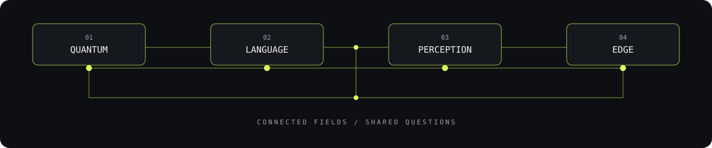

I explore how **computation becomes intelligence** — from quantum information and language models to systems that interpret real-world signals.

## FIELD NOTES

<table>
<tr>
<td width="50%" valign="top">

**01 / QUANTUM COMPUTING**

Quantum algorithms, quantum information, and quantum machine learning.

</td>
<td width="50%" valign="top">

**02 / LANGUAGE MODELS**

LLMs, transformer architectures, and multimodal language systems.

</td>
</tr>
<tr>
<td width="50%" valign="top">

**03 / MACHINE PERCEPTION**

Computer vision, speech AI, and learning from visual and acoustic data.

</td>
<td width="50%" valign="top">

**04 / EDGE INTELLIGENCE**

Sensor-driven AI, embedded systems, and models interacting with physical environments.

</td>
</tr>
</table>

## HOW I THINK ABOUT SYSTEMS

**Signal → Representation → Inference → Application**

I’m drawn to the full path: understanding the data, choosing a representation, testing a model, and connecting the result to a useful system.

## TOOLKIT

Currently learning: quantum software with Qiskit · LLM and multimodal tooling

**QUANTUM COMPUTING · LLMs · PERCEPTION · EDGE AI**

