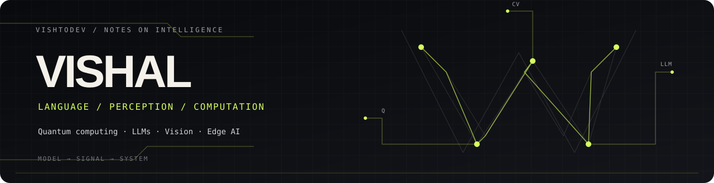

<div align="center">



<br/>

<a href="https://github.com/vishtodev">
  
</a>

### VISHAL R. / SYSTEMS & RESEARCH

**ECE undergraduate · VIT Chennai**

<code>QUANTUM COMPUTING</code> &nbsp; <code>LLMs</code> &nbsp; <code>MULTIMODAL AI</code> &nbsp; <code>COMPUTER VISION</code> &nbsp; <code>EDGE INTELLIGENCE</code>


</div>


<table>
<tr>
<td width="58%" valign="top">

## 00 / OPERATOR PROFILE

I'm an Electronics and Communication Engineering student exploring intelligent systems from two complementary directions: **emerging computation** (quantum computing and language models) and **real-world deployment** (vision, speech, sensors and edge devices).

I enjoy the full research loop: framing a question, building a baseline, testing an idea, analysing failure cases and turning the result into a working system.

</td>
<td width="42%" valign="top">

## 01 / LIVE CONTEXT

```yaml
identity: Vishal R.
base: VIT Chennai
degree: B.Tech / ECE

research:
  - quantum machine learning
  - LLMs and multimodal AI
  - speech and computer vision

build:
  - edge intelligence
  - embedded systems
  - applied deep learning
```

</td>
</tr>
</table>

## 02 / RESEARCH RADAR

<table>
<tr>
<td width="33%" valign="top">

<div align="center">

**[ Q ] QUANTUM**


</div>

Quantum algorithms, quantum machine learning, qubit representations and Qiskit.

</td>
<td width="34%" valign="top">

<div align="center">

**[ L ] LANGUAGE**


</div>

Transformers, LLMs, speech-language systems, multimodal learning and model reliability.

</td>
<td width="33%" valign="top">

<div align="center">

**[ V ] PERCEPTION**


</div>

Computer vision, remote sensing, speech analysis, embedded intelligence and AI for science.

</td>
</tr>
</table>

### CURRENT EXPERIMENTS

- **Glacial lake segmentation** — deep-learning research on satellite imagery at the Centre for Cyber Physical Systems (CCPS), VIT Chennai.
- **Emotion-aware speech research** — combining speech recognition and speech emotion recognition.
- **Foundations track** — deepening my understanding of quantum computing and modern language models.


## 03 / SELECTED BUILDS

*Projects are grouped by the kind of system they investigate—not by language or framework.*

<table>
<tr>
<td width="50%" valign="top">

### 01 — EmotionFusionNet

**SPEECH / AFFECTIVE COMPUTING**

Research work combining speech recognition with speech emotion recognition. Current work in progress; implementation is not yet available in a public repository.

`Speech AI` `Deep Learning` `Research`

</td>
<td width="50%" valign="top">

### 02 — ToLCV Risk Assessment

**AGRI-TECH / SPATIOTEMPORAL SYSTEMS**

A multi-node framework for whitefly forecasting and Tomato Leaf Curl Virus risk assessment. The repository documents data schemas, ingestion adapters, SQLite storage and temporal alignment; forecasting milestones are planned.

`Python` `SQLAlchemy` `Raspberry Pi` `IoT`

[INSPECT REPOSITORY ↗](https://github.com/vishtodev/ToLCV-Risk-Assessment)

</td>
</tr>
<tr>
<td width="50%" valign="top">

### 03 — Glacial Lake Segmentation

**EARTH OBSERVATION / COMPUTER VISION**

Deep-learning work on glacial lake segmentation from satellite imagery, developed during my CCPS research internship. Work in progress.

`Remote Sensing` `Segmentation` `Deep Learning`

</td>
<td width="50%" valign="top">

### 04 — Smart Sitting Posture Tracker

**EDGE DEVICE / HUMAN-CENTRED SENSING**

A wearable posture monitor using an MPU6050 motion sensor, ESP32 and BLE-connected Flutter app, with sensitivity modes, weekly analytics and an XP-based reward system.

`ESP32` `BLE` `Flutter` `Embedded`

[INSPECT REPOSITORY ↗](https://github.com/vishtodev/Smart-Sitting-Posture-Tracker)

</td>
</tr>
<tr>
<td width="50%" valign="top">

### 05 — AI Driver Monitoring

**REAL-TIME PERCEPTION**

Detects phone use and eye closure using YOLOv8 and OpenCV, confirms alerts across multiple frames and tracks a running attention score.

`Python` `OpenCV` `YOLOv8` `MediaPipe`

[INSPECT REPOSITORY ↗](https://github.com/vishtodev/AI-Driver-Monitoring-System)

</td>
<td width="50%" valign="top">

### 06 — Building Segmentation / U-Net

**PIXEL-LEVEL LEARNING**

A custom PyTorch U-Net for building segmentation on the Massachusetts Buildings Dataset, using Focal + Dice loss, mixed-precision training and IoU evaluation.

`PyTorch` `U-Net` `Computer Vision` `Remote Sensing`

[INSPECT REPOSITORY ↗](https://github.com/vishtodev/Building-segmentation-using-U-Net-architecture-with-PyTorch)

</td>
</tr>
</table>

<details>
<summary><b>MORE MODULES / OTHER BUILDS</b></summary>

- [MechFlight](https://github.com/vishtodev/mechflight) — 2D side-scrolling game built with Python, Pygame and MySQL score persistence.
- [Competitive Coding](https://github.com/vishtodev/Competitive-Coding) — Java solutions to algorithmic and number-theory problems.

</details>


## 04 / TOOLCHAIN

<div align="center">

**COMPUTE · MODELLING · PERCEPTION**


**EDGE · EMBEDDED · PROTOTYPING**


**ENGINEERING ENVIRONMENT**

`Qiskit` &nbsp; `YOLOv8` &nbsp; `MediaPipe` &nbsp; `ESP32` &nbsp; `MATLAB` &nbsp; `LTspice` &nbsp; `Cadence Virtuoso` &nbsp; `Keil` &nbsp; `Quartus`

**VERSION CONTROL & WORKFLOW**


</div>

## 05 / GITHUB TELEMETRY

<div align="center">


<br/>


</div>

<sub>Stats and language summaries are supplied by external services and may occasionally be unavailable or rate-limited.</sub>


## 06 / OPEN CHANNEL

<div align="center">

Interested in meaningful conversations around **Quantum Computing · LLMs · Multimodal AI · Research Engineering**.

<a href="https://github.com/vishtodev"></a>

<br/>

### `FROM QUBITS TO TOKENS — BUILDING SYSTEMS THAT MATTER.`

<sub>./end_of_readme · more experiments loading</sub>

</div>
