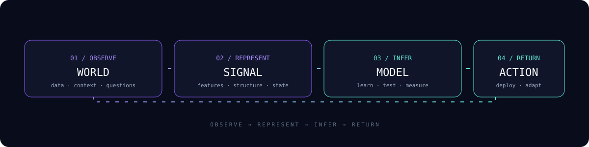

 

### VISHAL / INTELLIGENCE IN THE MAKING

Curious about the hidden structure behind intelligent systems.

 

`QUANTUM` &nbsp; / &nbsp; `LANGUAGE` &nbsp; / &nbsp; `PERCEPTION` &nbsp; / &nbsp; `EDGE`

## 01 — A little about my work

I like building things at the intersection of **AI, computation and the physical world**.

Some days that means exploring how language models represent information. Other days it means working with signals, images, sensors or an embedded device and asking: *can this idea become a system that actually works?*

I’m interested in the process as much as the result — designing experiments, understanding failure cases and improving a model beyond the first promising score.

## 02 — The research loop

## 03 — Current rabbit holes

<table>
<tr>
<td width="50%" valign="top">

### ◉ Quantum × AI

Quantum computing, quantum machine learning, state representations and the question of where quantum methods could meaningfully meet learning systems.

</td>
<td width="50%" valign="top">

### ◉ Language × Intelligence

LLMs, transformers, multimodal systems, speech-language interaction and the reliability of model reasoning.

</td>
</tr>
<tr>
<td width="50%" valign="top">

### ◉ Perception × Science

Computer vision, remote sensing, speech analysis and learning from real-world signals.

</td>
<td width="50%" valign="top">

### ◉ Intelligence × Edge

Sensor-driven systems, embedded AI, IoT and taking models beyond the notebook.

</td>
</tr>
</table>

## 04 — Things I’ve built

Small systems, real problems, lots of iteration.

<table>
<tr>
<td width="50%" valign="top">

### ToLCV Risk Assessment

A multi-node framework for whitefly forecasting and Tomato Leaf Curl Virus risk assessment. The repository covers data schemas, ingestion, storage and temporal alignment, with forecasting milestones planned.

`Python` `IoT` `Data Pipelines`

[EXPLORE THE REPO ↗](https://github.com/vishtodev/ToLCV-Risk-Assessment)

</td>
<td width="50%" valign="top">

### Smart Sitting Posture Tracker

A wearable posture monitor built around motion sensing, ESP32 and a BLE-connected Flutter app, with sensitivity modes and weekly analytics.

`ESP32` `MPU6050` `BLE` `Flutter`

[EXPLORE THE REPO ↗](https://github.com/vishtodev/Smart-Sitting-Posture-Tracker)

</td>
</tr>
<tr>
<td width="50%" valign="top">

### AI Driver Monitoring

A real-time vision system that detects phone use and eye closure, confirms alerts across frames and tracks an attention score.

`Python` `OpenCV` `YOLOv8` `MediaPipe`

[EXPLORE THE REPO ↗](https://github.com/vishtodev/AI-Driver-Monitoring-System)

</td>
<td width="50%" valign="top">

### Building Segmentation / U-Net

A custom PyTorch U-Net trained for building segmentation on aerial imagery, using Focal + Dice loss, mixed precision and IoU evaluation.

`PyTorch` `U-Net` `Computer Vision`

[EXPLORE THE REPO ↗](https://github.com/vishtodev/Building-segmentation-using-U-Net-architecture-with-PyTorch)

</td>
</tr>
</table>

<b>More experiments & side quests</b>

- [MechFlight](https://github.com/vishtodev/mechflight) — a 2D side-scrolling game with Python, Pygame and score persistence.
- [Competitive Coding](https://github.com/vishtodev/Competitive-Coding) — algorithmic and number-theory solutions in Java.
- **Speech emotion research** — exploring emotion-aware speech recognition; work in progress.
- **Glacial lake segmentation** — research on satellite imagery; work in progress.

## 05 — Tools I reach for

Also exploring: Qiskit · transformers · YOLOv8 · MediaPipe · MATLAB · LTspice

## 06 — Find me

  

### `QUBITS → TOKENS → SIGNALS`

still curious · still building

